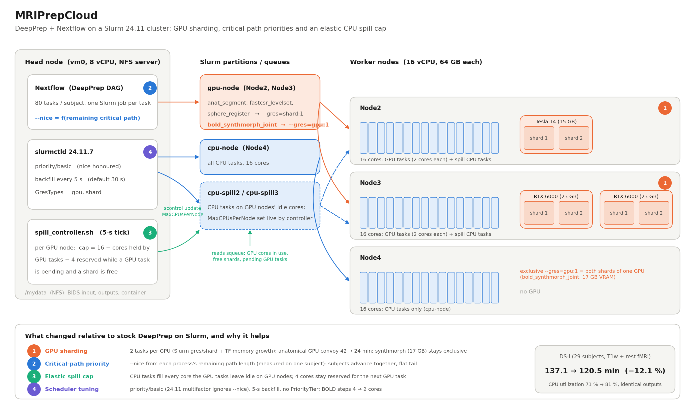
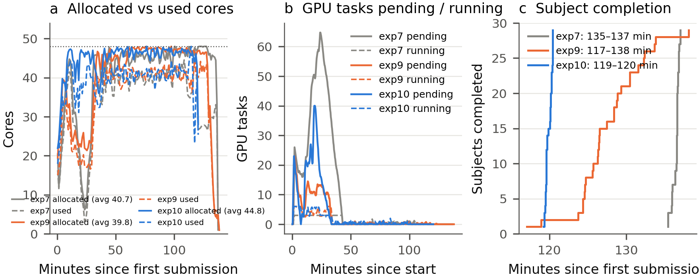

# MRIPrepCloud

**Faster neuroimaging preprocessing on small cloud GPU clusters.** MRIPrepCloud runs [DeepPrep](https://github.com/pBFSLab/DeepPrep) (the deep-learning successor of [fMRIPrep](https://github.com/nipreps/fmriprep)) on a 4-node Slurm cluster on the [FABRIC](https://fabric-testbed.net/) testbed and removes the scheduling idle time that the stock Nextflow/Slurm configuration leaves behind: GPU sharding, critical-path job priorities, an elastic CPU spill cap and a few Slurm 24.11 fixes. Workflow outputs are unchanged.

On the 29-subject professional-chess-players dataset (DS-I, T1w + resting-state fMRI) the same cluster finishes in **120.5 min instead of 137.1 min (−12.1 %)** with CPU utilization up from 71 % to 81 %, 2323/2323 tasks completed and no retries.

This repository continues the [DeepNeuroBench](https://github.com/xenificity/DeepNeuroBench) benchmark (IISWC 2026 artifact) and the [Neuroscience-on-FABRIC / IISWC-2026](https://github.com/MU-Data-Science/Neuroscience-on-FABRIC/tree/main/IISWC-2026) work of the MU Data Science group.



## How it works

DeepPrep expresses one subject as a Nextflow DAG of about 80 tasks; Nextflow submits each task as a Slurm job. On the stock configuration three things cost time on a 48-core / 3-GPU cluster:

1. **A GPU convoy at the start.** Every subject's anatomical chain begins with two GPU steps (`anat_segment`, `anat_fastcsr_levelset`). With one job per GPU, 29 subjects queue behind 3 GPUs for 42 min while most CPU cores wait for work that the DAG has not released yet.
2. **Idle cores on the GPU nodes.** GPU tasks reserve 2 cores; the remaining 14 cores per GPU node were either closed to CPU work or opened with a fixed cap that is wrong half of the time.
3. **A ragged tail.** Subjects finish at very different times; the last 25 min run on a fraction of the cluster.

MRIPrepCloud changes four things (numbers in the figure):

| # | Change | Where | Effect on DS-I |
|---|--------|-------|----------------|
| 1 | **GPU sharding**: each GPU is split into 2 Slurm shards; anatomical GPU steps ask for `--gres=shard:1`, `bold_synthmorph_joint` (17 GB VRAM) keeps an exclusive `--gres=gpu:1`. TensorFlow memory growth is passed into the container so two tasks fit on one GPU. | `slurm/slurm.conf`, `slurm/gres.conf.*`, `config/deepprep.slurm.config` | convoy 42 → 24 min, GPU-task wait 484 → 182 s |
| 2 | **Critical-path priority**: every job gets `--nice` from the remaining critical-path length of its process (measured once on a single-subject run), so all subjects advance together and the tail stays flat. | `config/deepprep.slurm.config` | last subject finishes 1 min after the first |
| 3 | **Elastic spill cap**: a 5-second controller sets `MaxCPUsPerNode` of the per-GPU-node spill partitions to `16 − cores held by GPU tasks − 4` (the 4 are reserved only while a GPU task is pending and a shard is free). CPU tasks fill every idle core without starving GPU tasks. | `scripts/spill_controller.sh` | idle-while-pending cores 23 → 3 during the convoy |
| 4 | **Scheduler tuning for Slurm 24.11**: `PriorityType=priority/basic` (the 24.11 default, multifactor without weights, gives every job priority 1 and ignores `--nice`), `bf_interval=5` (tasks last 1–7 min, the 30-s default leaves cores idle), no `PriorityTier` on the GPU partition (it held cores for GPU jobs that were only waiting for a shard). BOLD CPU steps right-sized from 4 to 2 cores (measured usage ≈ 2). | `slurm/slurm.conf`, `config/deepprep.patch` | tail uses 88 % of its allocated cores instead of 69 % |

Results, figures and the full write-up for DS-I are in [`results/`](results/) (report: [`results/MRIPrepCloud_DS-I_report.pdf`](results/MRIPrepCloud_DS-I_report.pdf)).

| | Baseline (DeepNeuroBench exp7) | MRIPrepCloud |
|---|---|---|
| Makespan, 29 subjects | 137.1 min | **120.5 min** |
| Minutes per subject | 4.73 | **4.15** |
| Average cores allocated (of 48) | 40.7 | 44.8 |
| CPU utilization | 71 % | 81 % |
| GPU convoy ends | 42 min | 24 min |
| Tasks completed / retries | 2323 / 2 | 2323 / 0 |



## Repository layout

```
fabric/Cluster_Creation.ipynb   FABRIC notebook: 1 head + 3 workers (1x T4, 2x RTX 6000), L2 network, /etc/hosts, SSH keys
slurm/install_slurm.sh          munge + Slurm 24.11.7 built from source and installed on every node
slurm/slurm.conf                cluster config (shards, partitions, priority/basic, 5-s backfill)
slurm/gres.conf.node2|node3     GPU → shard mapping per GPU node
slurm/deploy_shards.sh          fill in the shard counts, copy the configs to all nodes, restart Slurm
config/deepprep.slurm.config    Nextflow config: shard / exclusive GPU requests, critical-path --nice, spill queues
config/deepprep.patch           DeepPrep 25.1.0 patch: per-process core counts, Nextflow trace output
scripts/run_deepprep.sh         launch a run (DeepPrep + controller + monitor), summarize at the end
scripts/spill_controller.sh     per-node elastic spill cap
scripts/summarize_run.py        makespan, utilization, GPU waits and a utilization plot from the Nextflow report
results/                        DS-I figures and report
```

## Setup, from a FABRIC account to a run

The cluster is one head node (`vm0`, 8 vCPU, 16 GB, runs Nextflow, slurmctld and the NFS server) and three workers (`vm1`–`vm3`, 16 vCPU, 64 GB each). `vm1` has one Tesla T4, `vm2` two Quadro RTX 6000, `vm3` no GPU. Slurm names them Node1–Node4. All commands below run on `vm0` unless stated otherwise; the workers are reachable as `ssh vm1` etc. with passwordless sudo once the notebook has finished.

### 1. FABRIC account and cluster

1. Create an account at the [FABRIC portal](https://portal.fabric-testbed.net/) with your institutional login and join (or ask your PI to create) a **project**; the project lead approves the membership.
2. In the portal, generate a **bastion key** (*User Profile → Bastion login / SSH keys*) and a **sliver key**. Both are needed by the notebook. FABRIC's [getting-started guide](https://learn.fabric-testbed.net/knowledge-base/getting-started-with-fabric/) walks through this.
3. Open [FABRIC JupyterHub](https://jupyter.fabric-testbed.net/), run `jupyter_examples/start_here.ipynb` once to write `~/.fabric/config` (project ID, keys, bastion user).
4. Upload [`fabric/Cluster_Creation.ipynb`](fabric/Cluster_Creation.ipynb) to JupyterHub, set `SLICE_NAME`/`SITE` (a site with T4 and RTX 6000 availability; the first cell lists them) and run it. It creates the slice, assigns `192.168.1.{1..4}` on an L2 network, writes `/etc/hosts` (`vm0`–`vm3`, `Node1`–`Node4`) and distributes SSH keys. Renew the lease with `renew_slice(SLICE_NAME, days=14)` as needed.
5. SSH to the head node through the bastion (the notebook prints the command) and clone this repository:

```bash
git clone https://github.com/xenificity/MRIPrepCloud.git ~/MRIPrepCloud
```

### 2. Shared storage (NFS on vm0, mounted on all nodes at /mydata)

```bash
sudo apt-get install -y nfs-kernel-server && sudo mkdir -p /mydata && sudo chown ubuntu:ubuntu /mydata
echo "/mydata 192.168.1.0/24(rw,sync,no_subtree_check)" | sudo tee -a /etc/exports && sudo exportfs -a && sudo systemctl restart nfs-kernel-server
for v in vm1 vm2 vm3; do ssh $v 'sudo apt-get install -y nfs-common && sudo mkdir -p /mydata && sudo mount 192.168.1.1:/mydata /mydata &&
  echo "192.168.1.1:/mydata /mydata nfs auto,nofail,noatime,nolock,tcp,actimeo=1800 0 0" | sudo tee -a /etc/fstab'; done
```

### 3. Slurm 24.11 with GPU shards

Ubuntu 20.04 packages Slurm 19.05, which has no `gres/shard`; the script builds 24.11.7 from source once into `/mydata` and installs it on every node (munge included, about 10 min). Then deploy the configuration with the shard counts (2 per T4, 2 per RTX 6000 is the validated setting):

```bash
~/MRIPrepCloud/slurm/install_slurm.sh
~/MRIPrepCloud/slurm/deploy_shards.sh 2 2
sinfo -N -o "%N %T %c %G %P"      # Node2 gpu:1,shard:2  Node3 gpu:2,shard:4  Node4 (none)
```

`slurm/slurm.conf` assumes the node names and addresses from the notebook (`Node2`=192.168.1.2 with the T4, `Node3`=192.168.1.3 with the RTX 6000s, `Node4`=192.168.1.4). Edit the `NodeName` lines if your layout differs.

### 4. Singularity, the DeepPrep image and the FreeSurfer license

```bash
for v in vm0 vm1 vm2 vm3; do ssh $v 'sudo apt-get install -y singularity-container || sudo apt-get install -y apptainer'; done
sudo singularity build /mydata/deepprep_25.1.0.sif docker://pbfslab/deepprep:25.1.0     # ~15 min
mkdir -p /mydata/freesurfer_key && cp ~/license.txt /mydata/freesurfer_key/            # free license: https://surfer.nmr.mgh.harvard.edu/registration.html
```

If `apt` has no Singularity package for your image, build it from source as in [DeepNeuroBench's `install_singularity.sh`](https://github.com/xenificity/DeepNeuroBench/blob/main/src/install_singularity.sh).

### 5. DeepPrep sources, patch and config

```bash
git clone https://github.com/pBFSLab/DeepPrep.git /mydata/DeepPrep && cd /mydata/DeepPrep && git checkout 25.1.0
git apply ~/MRIPrepCloud/config/deepprep.patch
cp ~/MRIPrepCloud/config/deepprep.slurm.config /mydata/DeepPrep/deepprep/nextflow/cluster/
```

The patch only changes declared `cpus` of seven processes to their measured usage and adds `-with-trace`; no processing step is altered. The config's priority table (`pn`) holds the remaining critical path, in seconds, of every DeepPrep process; the subject table (`sn`) is a tie-break ranking for DS-I and is simply unused (rank 0) for other subject IDs.

### 6. Data (BIDS)

Any BIDS dataset with T1w and (optionally) BOLD runs works. The DeepNeuroBench datasets are on Hugging Face:

```bash
pip install huggingface_hub
mkdir -p /mydata/data && cd /mydata/data && hf download xenificity/ProfessionalChessPlayersMRI --repo-type dataset --local-dir .   # DS-I, 1.1 GB
```

### 7. Run

```bash
cd ~/MRIPrepCloud
setsid nohup scripts/run_deepprep.sh /mydata/data/chess_data/bids /mydata/output/chess_data/run1 rest > run1.log 2>&1 < /dev/null &
```

The script starts DeepPrep (`--executor cluster`, Slurm), the spill controller and a 15-s queue/GPU monitor, and survives a dropped SSH session. Watch it with `squeue`, `tail -f /mydata/output/chess_data/run1/mriprepcloud/status.log`, or `sinfo -N -o "%N %C %G"`. Environment overrides: `DEEP_PREP_HOME`, `SINGULARITY_IMG`, `FS_LICENSE`, `CONFIG`, and `RESERVE`/`MIN` for the controller.

### 8. Results

At the end the run script prints the summary and writes `mriprepcloud/utilization.png` into the output directory. For any finished run:

```bash
scripts/summarize_run.py /mydata/output/chess_data/run1
```

```
makespan              120.5 min   (4.15 min/subject, 29 subjects)
tasks               2323/2323 completed, 0 retried/failed
cores allocated        44.8 of 48 on average
CPU utilization        81.0 %   (4682 core-min of work)
GPU task wait           182 s mean, 1168 s max (174 GPU tasks)
```

Outputs (`/mydata/output/<dataset>/run1/{BOLD,Recon,QC}`) are byte-identical in content to a stock DeepPrep run; only scheduling changed.

## Notes and limits

- Two shards per GPU are safe for every DeepPrep GPU step (largest: `anat_segment`, 7.1 GB) except `bold_synthmorph_joint` (17.3 GB), which keeps an exclusive GPU. DeepPrep's own GPU dispatcher only checks total memory, so do not raise the shard count without checking VRAM.
- The gain comes from idle time removed, not work removed: the sum of CPU work is the same (4682 vs 4668 core-min). Sharing a GPU slows each GPU task by about 20 %, which the shorter convoy more than repays.
- `scontrol reconfigure` resets `MaxCPUsPerNode` to the file values; the controller re-applies its cap within 5 s.
- Next step, in progress: replacing further CPU-bound DeepPrep steps (surface reconstruction, BOLD confounds) with GPU implementations.

## References

- DeepPrep: Ren, J. et al. *DeepPrep: an accelerated, scalable and robust pipeline for neuroimaging preprocessing empowered by deep learning.* Nature Methods (2025). Code: <https://github.com/pBFSLab/DeepPrep>, docs: <https://deepprep.readthedocs.io/>
- fMRIPrep: Esteban, O. et al. *fMRIPrep: a robust preprocessing pipeline for functional MRI.* Nature Methods 16, 111–116 (2019). Code: <https://github.com/nipreps/fmriprep>
- DeepNeuroBench (IISWC 2026 artifact): <https://github.com/xenificity/DeepNeuroBench>
- Neuroscience on FABRIC, IISWC 2026: <https://github.com/MU-Data-Science/Neuroscience-on-FABRIC/tree/main/IISWC-2026>
- FABRIC testbed: Baldin, I. et al. *FABRIC: A National-Scale Programmable Experimental Network Infrastructure.* IEEE Internet Computing 23(6), 38–47 (2019). <https://fabric-testbed.net/>
- Nextflow: Di Tommaso, P. et al. *Nextflow enables reproducible computational workflows.* Nature Biotechnology 35, 316–319 (2017).
- Slurm GPU sharding (`gres/shard`): <https://slurm.schedmd.com/gres.html#Sharding>
- Professional chess players dataset (DS-I): <https://huggingface.co/datasets/xenificity/ProfessionalChessPlayersMRI>

## License

Apache 2.0, see [LICENSE](LICENSE). DeepPrep and fMRIPrep are distributed under their own licenses.
